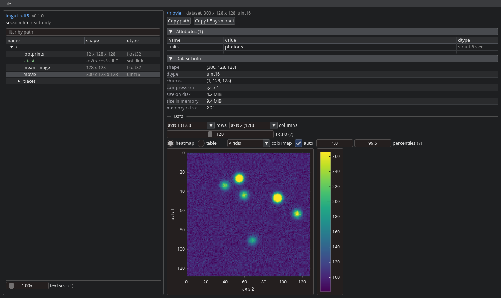
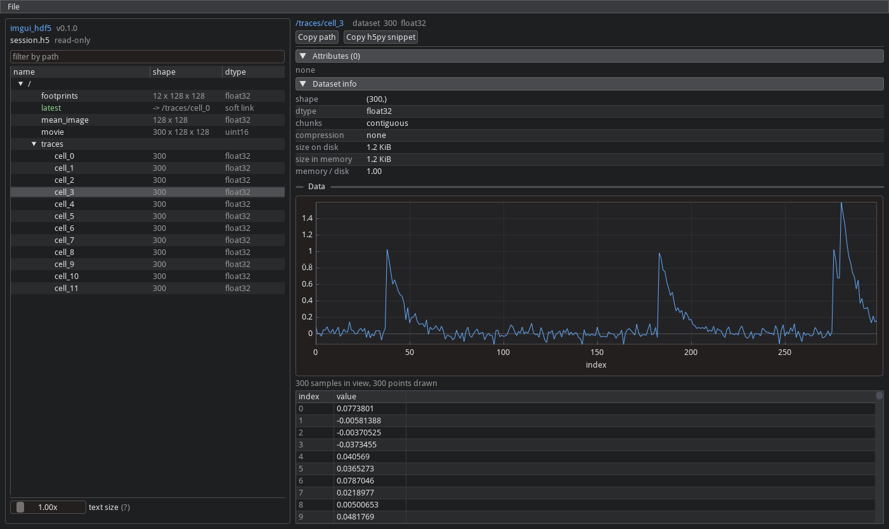

# imgui_hdf5

A read-only HDF5 file viewer on [imgui-bundle](https://github.com/pthom/imgui_bundle).



## Install

Run it straight from GitHub, no clone:

```bash
uvx --from git+https://github.com/FlynnOConnell/imgui_hdf5 imgui-hdf5 path/to/file.h5
```

Or inside an environment that already has imgui-bundle (only this package is added):

```bash
uv run --with git+https://github.com/FlynnOConnell/imgui_hdf5 imgui-hdf5 path/to/file.h5
```

From a clone:

```bash
git clone git@github.com:FlynnOConnell/imgui_hdf5.git
cd imgui_hdf5
uv venv -p 3.12 && uv pip install -e ".[dev]"
imgui-hdf5 path/to/file.h5
```

Dependencies: `imgui-bundle`, `numpy`, `h5py` and [imgui_data_loader](https://github.com/FlynnOConnell/imgui_data_loader).
The `debug` extra adds [imgui_debugger](https://github.com/FlynnOConnell/imgui_debugger) and with it a Debug menu.

## Use

- Open a file from the command line (`imgui-hdf5 path/to/file.h5`), File > Open (type a path) or File > Open
  recent. Files open read-only. Recent files are kept in `~/.imgui_hdf5/settings.json`.
- The tree on the left lists groups and datasets with their shape and dtype; groups are read when opened. The filter
  box matches on the path. Soft and external links are listed, not followed; a soft link's page has Go to target.
- The page on the right shows the node's attributes, the dataset's chunks, compression and size on disk and in
  memory, and a view by shape: the value of a scalar; a line plot and a table for 1-D; a heatmap or a table for 2-D;
  for 3-D and up, the two axes that form the image and a slider for each other axis. Compound datasets get a column
  per field. A group holding a CSR, CSC or COO sparse matrix is shown as a dense 2-D array when small, else as its
  structure, with a button to read it anyway.
- Only what is on screen is read: a long line is read in strides and drawn as the min and max of each bin, a large
  image every k-th row and column until zoomed in.
- Copy path and Copy h5py snippet (`f["a/b"][...]`) above each page.
- Text size: Ctrl + / Ctrl -, Ctrl 0, the slider under the tree, or `--scale 2`.


